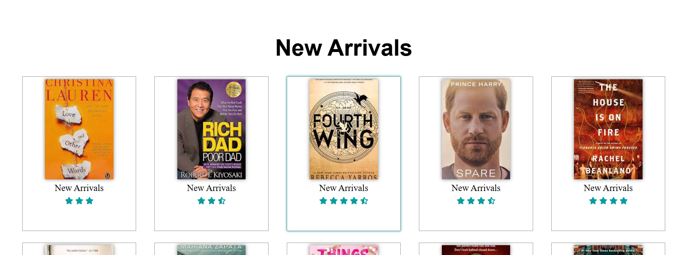
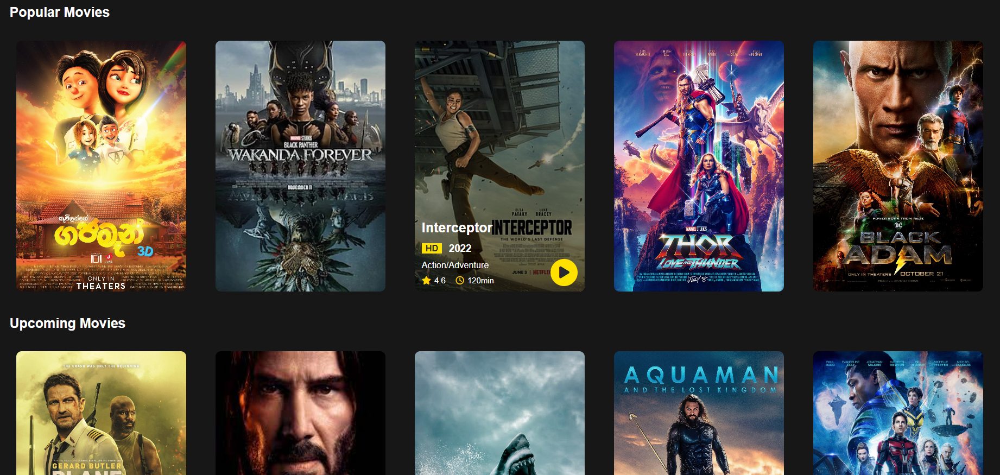

# Book & Movie Website

A multi-page **bookstore and movie-gallery website** developed as a frontend web-development project. It combines a bookstore-style catalog, new-arrival book displays, and a separate entertainment page showcasing movies and TV shows.

## Screenshots

### Bookstore — New Arrivals



### Movie & TV Gallery



## Features

**Bookstore (`index.html`)**
- Featured books and prices arranged in a catalog layout
- New-arrivals gallery with book covers and visual ratings
- Free eBook listings linking to external websites in the original coursework
- Navigation between book sections and the movie page

**Movies & TV (`m1.html`)**
- Featured, popular, and upcoming movie sections
- TV-show showcase, poster cards, and visual film information
- Sliding featured-movie section using Swiper.js
- Poster-card layouts, hover effects, and visual navigation

## Technologies

- **HTML5** — page structure and content
- **CSS3** — layouts, galleries, colors, and hover effects
- **Swiper.js** — featured-content slider (loaded via CDN)
- **Font Awesome** — icons (loaded via CDN)

This is a **frontend demonstration**, not a deployed e-commerce or streaming platform. There is no payment backend, movie playback service, account system, or operational newsletter service.

## Project Structure

```text
Book-and-Movie-Website/
├── index.html                 # Bookstore homepage
├── index (2).html             # Original homepage filename (preserved)
├── m1.html                    # Movies and TV page
├── style.css                  # Bookstore stylesheet
├── style0.css                 # Additional original stylesheet
├── style1.css                 # Additional original stylesheet
├── m1.css                     # Movie-page stylesheet
├── image/                     # Original book covers, posters, and graphics
├── screenshots/
│   ├── bookstore-new-arrivals.png
│   └── movie-gallery.png
└── README.md
```

## Run Locally

1. Download or clone this repository.
2. Open `index.html` in a web browser.
3. Select **Movies** in the navigation bar to open `m1.html`.

No server or package installation is required for the main pages. An internet connection may be needed to load the externally hosted icons, slider library, and some remote images.

## Project Notes

This repository preserves the original student project and its original book/movie presentation. Some external links may be outdated or point to websites that do not have permission to distribute the associated books; they are not endorsed as legal download sources. Review or replace those links before deploying the site publicly. Book covers, movie posters, and other third-party images may also have reuse restrictions.

**Collaboration:** The original website footer credits **Julia, Majd, and Hussein** for the design. Credit and publication permissions should be confirmed with the original contributors.
